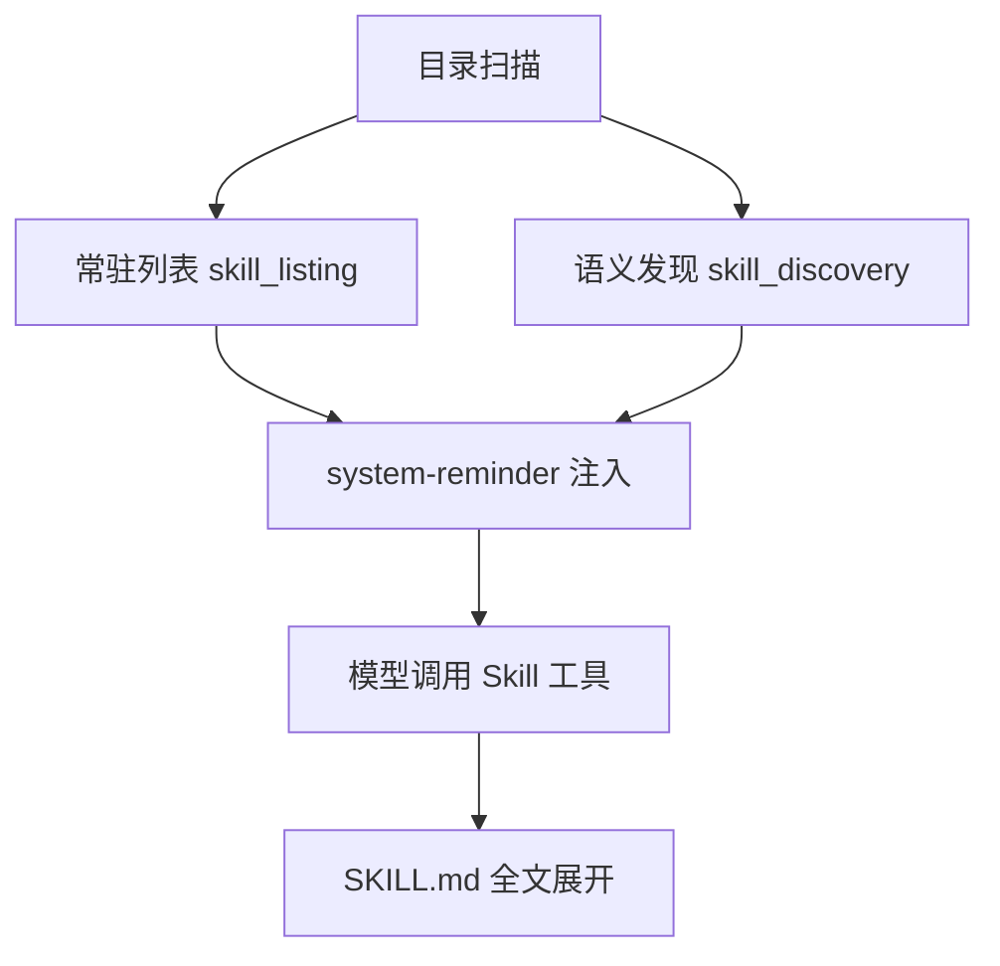
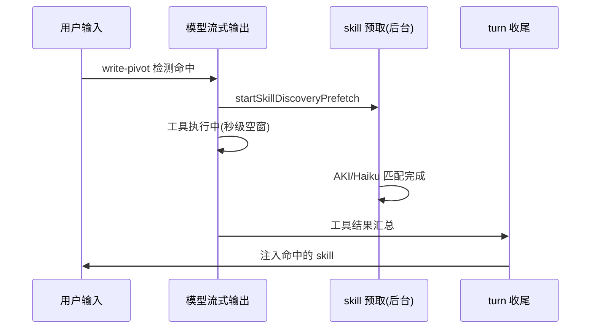

# Skill 注入与匹配机制

> 本文聚焦 Skill 的**上下文注入管线**与**发现匹配机制**（`attachments.ts` 管线 + ant-internal skillSearch）。
> 命令注册/类型系统见 [CLI 命令系统](../cli/overview.md#skill-系统)；本文是其下游：模型如何"看到"并"用上"技能。

## 概述

Skill 从磁盘上的 `SKILL.md` 到被模型使用，经过四个阶段：



1. **发现（扫描）**：`getSkillToolCommands(cwd)` 扫描 `~/.claude/skills/`、项目 `.claude/skills/`、内置与 MCP 来源，解析 frontmatter 的 `name`/`description`
2. **常驻列表（skill_listing）**：全量列表注入上下文，增量更新
3. **语义发现（skill_discovery）**：按用户输入语义命中，按需注入（feature gated）
4. **调用（Skill 工具）**：模型自主决定调用，读取 SKILL.md 全文展开为 prompt

## 常驻列表（skill_listing）

定义于 `src/utils/attachments.ts` 的 `getSkillListingAttachments()`（约 :2710），经 `maybe('skill_listing', …)` 挂入 attachment 管线（:895），渲染于 `messages.ts` 的 `case 'skill_listing'`（:3808，`The following skills are available for use with the Skill tool:`）。

### 增量注入的字节会计

理解本节的前提是 LLM API 的 prompt cache 计费：两次请求的 messages 若前缀 N 字节完全一致，前缀按缓存价（约 1/10）计费且推理提速；**任何字节变化 → 从变化点起全部失效 → 全价重算**。由此推出注入管线的第一原则：*能不变的字节就不变，必须变的放尾部*。

`sentSkillNames`（`Map<agentKey, Set<name>>`）实现三层精确记账：

```typescript
const agentKey = toolUseContext.agentId ?? ''     // ① 线程隔离
let sent = sentSkillNames.get(agentKey)
...
const newSkills = allCommands.filter(cmd => !sent.has(cmd.name))  // ② 增量判定
if (newSkills.length === 0) return []             // ③ 零字节静默
const isInitial = sent.size === 0                 // ④ 首批/增量标记
for (const cmd of newSkills) sent.add(cmd.name)
```

- **① agentKey 线程隔离**：主线程 `agentId` 为空串，每个子代理各一份记账。子代理上下文独立——若共享 Set，主线程发过后子代理永远看不到列表
- **② 增量 = 追加而非重写**：新建 skill 后下一轮只注入一行 `- name: description`；既有行原封不动（cache 不 bust）
- **③ 零字节静默**：无新增的轮次返回空数组——0 token 成本
- **④ `isInitial`**：区分全量首提与增量追加，供渲染端调整措辞

注入体积还经 `formatCommandsWithinBudget(newSkills, contextWindowTokens)` 按模型上下文窗口限流，防大规模 skill 集把列表撑成巨块。

### resume 抑制（:2755）

`claude --resume` 恢复会话时，transcript 里**已有旧的全量列表**（历史消息原样保留）。不抑制的话恢复后首轮再注入全量 → 列表在上下文出现两次（2.2K×2 纯浪费）且内容可能不一致。`suppressNext` 一次性标志：恢复后首次调用把当前全部 skill 标记为"已发"并静默返回。

### 实测时间线

新建 skill 后下一轮 system-reminder **只多一行** `- vfio-looking-glass: KVM/VFIO …`；既有 22 行字节不变（cache 命中）。即：全量列表是**一次性成本**（约 2.2K tokens，进 cache 后为缓存价），此后每轮增量趋近于零。

### 字节稳定性：prompt cache 经济学

`relevant_memories` 的 `header` 字段注释是最佳教材（attachments.ts）：

```
Pre-computed header string (age + path prefix). Computed once
at attachment-creation time so the rendered bytes are stable
across turns — recomputing memoryAge(mtimeMs) at render time
calls Date.now(), so "saved 3 days ago" becomes "saved 4 days
ago" across turns → different bytes → prompt cache bust.
```

问题链条：30 字节的年龄标签每天 +1 → 字节变化 → 前缀 cache 从该处 bust → **炸掉它前面几万 token 的缓存**。

修复模式：**创建时固化**——`header?: string` 在 attachment 创建时计算一次存入，渲染只读；旧会话无该字段才回退重算。所有带时间/计数/状态的注入内容均适用。Skill 列表天然满足（description 是静态文本），因此增量注入 + 字节固化组合下，列表的 cache 贡献是"永久命中"。

## 语义发现（skill_discovery）

由 ant-internal 的 skillSearch 模块提供（`src/services/skillSearch/`——外部构建中为 feature-gated stub，见 [构建系统与功能标记](../cli/build-system.md)）。attachment 类型定义于 attachments.ts:541。

### 两条触发路径

| 路径 | 触发点 | 阻塞性 | 实现位置 |
|------|--------|--------|----------|
| **turn-0** | 每条用户输入（input 文本即检索信号） | **阻塞**（"the one signal where there's no prior work to hide under"——首条消息没有先前工作可供隐藏，只能同步等待） | `getTurnZeroSkillDiscovery(input, messages, context)`，attachments.ts:825 |
| **turn 间预取** | write-pivot 检测（对话转向写操作时才启动） | **后台**（模型流式输出/工具执行期间运行，post-tools 与 memory prefetch 一同消费） | `startSkillDiscoveryPrefetch`，query.ts:354 |

历史演进（query.ts:351 注释）：旧的阻塞式 `assistant_turn` 路径在生产环境 **97% 的调用一无所获**，被替换为预取式；预取在 turn 结束前完成的比率 **>98%**（AKI@250ms / Haiku@573ms 对比 turn 时长 2-30s）。

### 匹配引擎：双通道语义匹配（ant-internal）

匹配是**语义级**而非关键词 if-else。query.ts:1709 注释泄露了双引擎延迟指纹：

- **AKI@250ms** —— 内部语义检索索引服务（embedding 检索）
- **Haiku@573ms** —— 小模型实时相关性判断（对输入与候选 skill description 评估）

`signals.ts`/`localSearch.ts` 的具体算法在 ant-internal 闭源；开源构建中为 noop stub（`feature('EXPERIMENTAL_SKILL_SEARCH')` DCE）。`DiscoverySignal` 类型为 `any`（stub 兜底）。

### 抑制门（skipSkillDiscovery）

技能调用时，SKILL.md 全文会作为 `input` 走 attachment 提取 @-mentions——但这不是用户意图，不得触发发现。`options.skipSkillDiscovery` 门（attachments.ts:815-827 注释）封住此路径：否则一个 110KB 的 SKILL.md 会引发 ~3.3s 的分块 AKI 查询（会话 13a9afae 实测）。

### 演进：从阻塞式到 write-pivot 预取（97% → 0 的优化）

需求：让"这条消息可能用到的 skill"与消息本身出现在**同一轮**——注入晚了（下一轮才出现）就失去意义。

**旧方案**（已替换）：`assistant_turn` 信号——每轮阻塞式在 `getAttachmentMessages` 内跑匹配。生产数据：**97% 的调用一无所获**（大部分轮次用户在连续对话，不需要新 skill）→ 每轮白白阻塞几十到几百毫秒。

**新方案**（query.ts:351-358，注释原文："uses findWritePivot guard that returns early on non-write iterations"）：

- **turn-0 阻塞保留**（attachments.ts:811）："the one signal where there's no prior work to hide under"——会话首条消息没有任何先前工作可供隐藏预取，只能同步等（250-573ms 可接受）
- **turn 间改为预取**：`findWritePivot` guard 只在**对话转向写操作**时启动（模型要动文件系统了，可能需要 skill）；预取在模型流式输出/工具执行的空窗内后台运行，turn 收尾时与 memory prefetch 一同消费（query.ts:1704-1715）



结果：同步阻塞从**每轮一次**降为 **turn-0 一次**；预取及时率 **>98%**（"should be >98% at AKI@250ms / Haiku@573ms vs turn durations of 2-30s"，query.ts:1709）。模式总结：**用免费空闲窗口（模型输出/工具执行的等待期）买掉同步延迟**——与 memory prefetch 采用同一套基础设施（query.ts 的 pendingMemoryPrefetch 与 pendingSkillPrefetch 并列消费）。

### 匹配引擎的性质：语义，而非关键词

双引擎均为语义层：AKI 检索命中与字面重合无关（"GPU 直通"可命中 description 写作 "passthrough" 的 skill）；Haiku 对输入与候选 description 做相关性评估。**但描述措辞承担召回责任**——语义检索的质量取决于 description 与用户表达的语义距离。实践：description 罗列用户真实会说的同义表达（中英混排、别名、错误代码、相关工具名）。

## 调用与展开

模型看到列表/命中后调用 Skill 工具 → `getMessagesForPromptSlashCommand` 将 SKILL.md 全文展开为用户消息。此路径设置 `skipSkillDiscovery`（见上）。展开产物中若有 @-mentions 走正常附件提取。

## 外部构建的实际行为（feature 开关关闭时）

`feature('EXPERIMENTAL_SKILL_SEARCH')` 由 GrowthBook 驱动（`services/analytics/growthbook.ts`，需内部 client key）。关闭时（开源构建默认）：

| 组件 | 状态 |
|------|------|
| `skillSearchModules`（signals/localSearch/prefetch/featureCheck） | noop stub，`skill_discovery` **从不产生** |
| `DiscoverSkillsTool`（DISCOVER_SKILLS_TOOL_NAME） | null，工具不注册（prompts.ts:89-96） |
| `skill_listing` | **正常工作**（不依赖该 feature） |

因此外部构建的实际行为是 **"全量列表模式"**：

- 全部 skill（含描述）常驻上下文，模型自行按用户意图选择
- 新建/重载 skill 由 listing delta 注入完整描述
- 无漏检风险（模型全看得到），代价为每轮 ~2K tokens 的列表开销
- 语义匹配不可用意味着 **description 措辞承担全部召回责任**（见下）

## SKILL.md 撰写实践

1. **description 是唯一的召回面**：语义引擎（匹配用户表达与描述的语义距离）和模型（全量列表下直接阅读）都依赖它。写法：罗列用户真实会说的同义表达（中英混排、别名、错误代码、相关工具名）
   - 反例：`description: 一个技能`
   - 正例：`GPU 直通 / 显卡直通 / vfio / looking glass / Code 43 / ACE 反作弊`
2. **name 用小写连字符**，与目录名一致（扫描以目录为单位）
3. **正文即 prompt**：会被全文展开，写操作指南而非介绍性文字
4. **避免巨型 SKILL.md**：调用时会触发 attachment 提取，体积直接影响该路径耗时（见抑制门一节）

## Session 0：guest agent 内显示 API 失效的根源

Windows 自 Vista 起将服务隔离在 **Session 0**（纯后台、无交互桌面），用户桌面在 Session 1+。`qemu-guest-agent` 以 SYSTEM 服务运行于 session 0，其 `guest-exec` 派生的所有子进程继承该会话——**user32 显示拓扑 API（EnumDisplayDevices / ChangeDisplaySettingsEx）在 session 0 看不到、也改不了用户会话的显示环境**。

实测对照（GPU 直通排障中主屏切换失败的第一现场）：

| 执行环境 | EnumDisplayDevices | ChangeDisplaySettingsEx |
|----------|--------------------|--------------------------|
| guest agent（session 0） | 首调即 false，适配器循环零输出 | 无效（改的是 session 0 假环境） |
| 计划任务 `/IT`（用户交互令牌） | 正常枚举全部适配器 | 生效 |

解法：以**用户交互令牌**在用户会话中执行——

```powershell
schtasks /create /tn <name> /tr "<cmd>" /sc once /st 00:00 /ru <user> /it /f
schtasks /run /tn <name>
```

`/IT`（interactive token）使任务运行于已登录用户的会话。附加教训：诊断也要选对时机——设备处于 Disabled/异常态时枚举结果为空并不代表拓扑真相。

## 成本模型

| 维度 | 按需命中（AKI/Haiku，ant-internal） | 全量列表（外部构建） |
|------|--------------------------------------|----------------------|
| 可见性 | 仅注入语义命中的 skill | 全部常驻 |
| 选择者 | 匹配器预筛 + 模型 | 模型直接阅读 description |
| 上下文成本 | 省列表 token | 每轮 ~2K tokens 常驻（进 cache 后为缓存价） |
| 漏检风险 | 匹配器未召回则模型不可见 | 无——模型全看得到 |
| 依赖 | GrowthBook + 内网 AKI 服务 | 无 |

外部构建无劣势：全量列表下模型自主选择，唯一代价是常驻 token 开销（23 个 skill 约 2K tokens，规模内可接受）。这也决定了 **description 措辞是外部构建下唯一的召回杠杆**（见 SKILL.md 撰写实践）。

## 调试

- 确认扫描结果：`getSkillToolCommands(cwd)` 的返回即模型可见集合（MCP/插件/用户目录去重后）
- 确认注入：transcript 中搜 `The following skills are available`（全量）与 `(matches your intent)`（命中）
- 外部构建下 `skill_discovery` 恒为空——只应观察到 `skill_listing`（全量 + delta）
